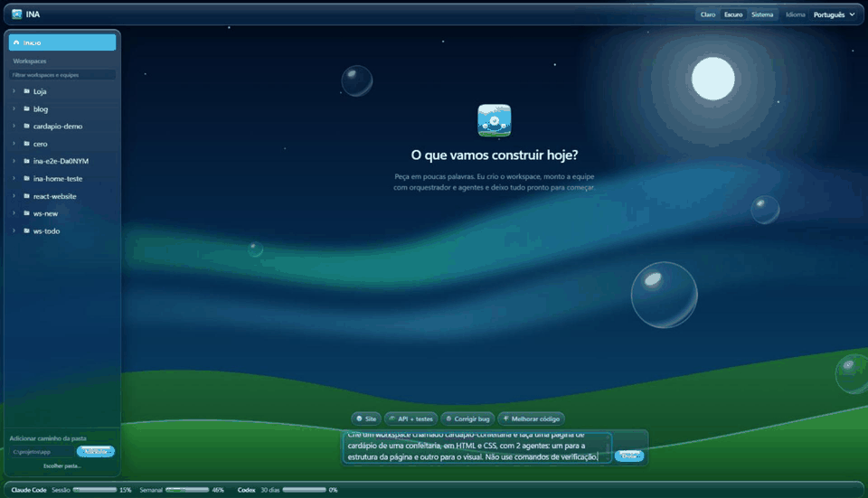
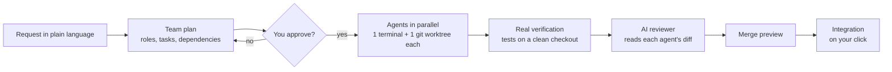
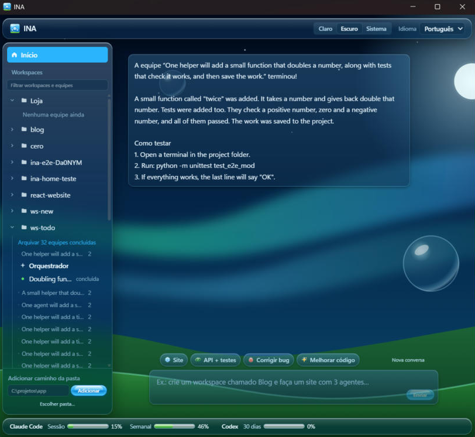
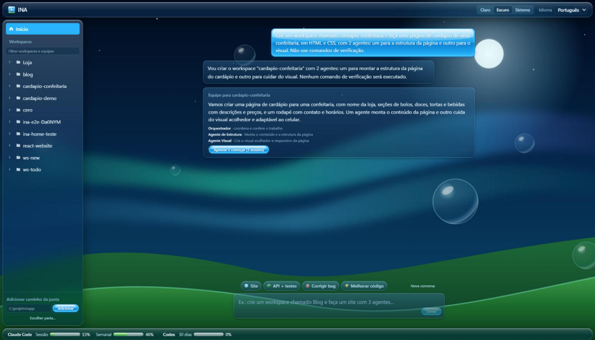
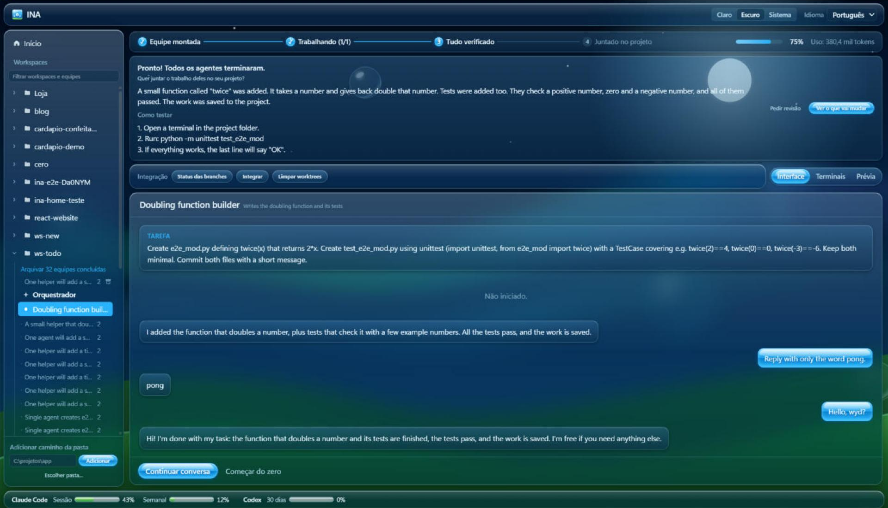
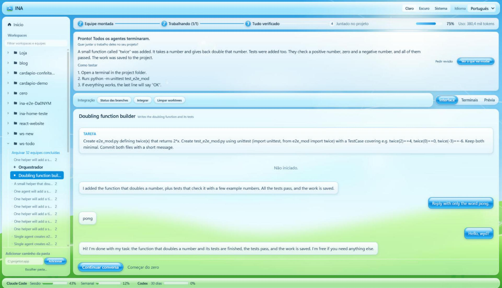

<p align="center">
  
</p>

<h1 align="center">INA</h1>

<p align="center"><strong>A team of AI agents working on your project — with you in charge.</strong></p>

<p align="center">
  <a href="https://github.com/ianeusantiago/Ina/releases/latest"></a>
  <a href="https://github.com/ianeusantiago/Ina/actions/workflows/ci.yml"></a>
  
  <a href="LICENSE"></a>
</p>

<p align="center"><a href="README.md">Português</a> (main documentation)</p>

---

INA is a Windows desktop app that assembles and coordinates a **team of AI agents**: one **orchestrator** plus several **agents**, each running the real [Claude Code](https://docs.claude.com/claude-code) CLI in its own terminal and its own copy of the project (git worktree). Describe what you want, approve the plan, and follow everything in a chat-like interface.

<p align="center">
  
</p>

**By the numbers:** about 8k lines of Rust and 4.5k of TypeScript, 87 Rust tests (unit and integration with real git), Vitest UI tests, Playwright E2E and Windows CI on every PR.

## Why I built INA

INA was born from a pain point. Most agent orchestrators only show terminals: the conversation with the orchestrator and the agents happens there, among values, logs and technical terms that are hard to follow for someone who is just starting. There is no comfortable place to talk to them, like the Claude, ChatGPT or Gemini desktop apps.

I wanted anyone to be able to use an agent orchestrator, even without AI experience, without knowing prompt engineering and without understanding everything that happens behind the scenes. So in INA you create a project with a short request, as in the GIF above, and chat with the orchestrator and each agent. You can see each agent's task, the next tasks and whether the orchestrator has already handed the work over. That visibility builds a closer connection with the AI and helps you understand what it is doing.

I also added features I missed in the orchestrators I used, with a look I really like: Frutiger Aero.

I believe agent orchestrators will become far better known, because they suit large projects, and much more accessible to people who don't use them yet. INA is my bet on that path.

## Download

1. Get **`INA_x.y.z_x64-setup.exe`** from **[Releases](https://github.com/ianeusantiago/Ina/releases/latest)** and install it.
2. If Windows shows "Windows protected your PC", click **More info → Run anyway** (the installer has no code-signing certificate yet).
3. New versions show up inside the app: **New version available → Update and restart**.

**Requirements:** Windows 11, [Claude Code](https://docs.claude.com/claude-code) installed and logged in, and [Git](https://git-scm.com/). Agents use **your** Claude plan; INA shows how much each team used.

## How it works

1. **Ask on the Home screen** — e.g. _"Create a workspace called Shop and build a product page with 2 agents"_ — or start from a template. INA creates the project folder, sets up the team and shows the plan.
2. **Approve.** Nothing runs before you approve. Each agent gets its own copy of the project.
3. **Follow along in the Interface.** Chat with the orchestrator and each agent. Permission requests show up as **Allow / Always allow / Deny** cards.
4. **Get the result.** When everyone is done, INA writes a plain summary (what was done, how to try it), offers an AI **review**, and merges the work after a conflict-free preview.



## Screenshots

| Home: ask in plain language | Plan: review before approving |
| --- | --- |
|  |  |

| Finished team (dark theme) | Finished team (light theme) |
| --- | --- |
|  |  |

## Highlights

- Real terminals (ConPTY), dependency-aware scheduling, real verification of results, controlled integration that never deletes unmerged work.
- Tree sidebar with live status, progress panel, token usage per team, Windows notifications, resume conversations after restarting.
- In-app project preview (sandboxed), signed auto-updates, Frutiger Aero look with light/dark/system themes, Portuguese and English UI.

Security model and known limits: [SECURITY.md](SECURITY.md) (in Portuguese).

## About the look: Frutiger Aero

INA is designed in the **Frutiger Aero** style — the aesthetic of mid-2000s to early-2010s tech (think Windows Vista and 7, Mac OS X Aqua): glossy translucent glass, blue skies, water and bubbles, green hills, light reflections and a hopeful take on technology. In INA it shows in the day/night sky background, glass panels, glossy Aqua buttons and the glass icon. More: [Frutiger Aero on Wikipedia](https://en.wikipedia.org/wiki/Frutiger_Aero).

## Development

Extra requirements: Rust (stable, MSVC), Visual Studio Build Tools 2022, Node.js 22+.

```sh
npm install
npm run tauri dev
npm test && npm run lint && npx tsc --noEmit
cd src-tauri && cargo fmt --check && cargo clippy --all-targets -- -D warnings && cargo test
```

CI runs these checks on every PR. Push a `v*` tag to build, sign and publish a release. See [README.md](README.md#desenvolvimento) for E2E tests and the code layout.

## License

[MIT](LICENSE) © 2026 Ian Santiago
